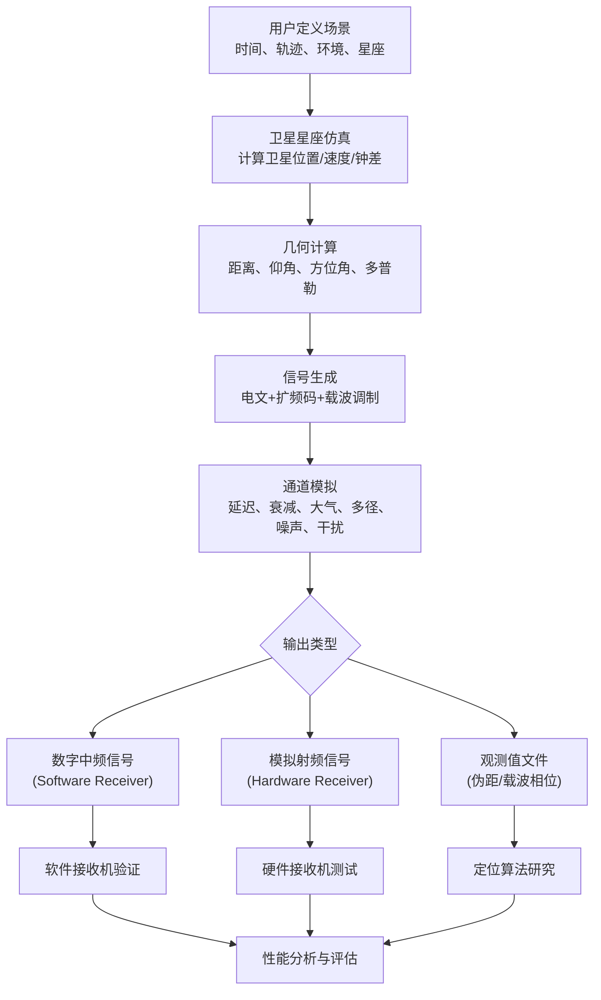

<p align="center">
  <br>
   <strong></strong>
</p>
<h1 align="center">
  🛰️ 📡 🖥️ GNSS 信号仿真原理总述
  <br>

</h1>

<p align="center">
  
  
  
  
  
</p>


## 📖 目录

- [📖 目录](#-目录)
- [🎯 什么是 GNSS 信号仿真？](#-什么是-gnss-信号仿真)
- [🚀 为什么需要仿真？](#-为什么需要仿真)
- [🧩 仿真系统的核心组成部分](#-仿真系统的核心组成部分)
  - [1. 场景生成器 (Scenario Generator)](#1-场景生成器-scenario-generator)
  - [2. 卫星星座仿真器 (Constellation Simulator)](#2-卫星星座仿真器-constellation-simulator)
  - [3. 信号生成器 (Signal Generator)](#3-信号生成器-signal-generator)
  - [4. 通道模拟器 (Channel Simulator)](#4-通道模拟器-channel-simulator)
  - [5. 输出与接口](#5-输出与接口)
- [⚙️ 仿真流程总览](#️-仿真流程总览)
- [🔢 核心数学模型](#-核心数学模型)
  - [信号数学模型](#信号数学模型)
  - [误差模型汇总](#误差模型汇总)
- [🎭 仿真类型与保真度](#-仿真类型与保真度)
- [📚 文档体系与学习路径](#-文档体系与学习路径)
- [💡 应用场景](#-应用场景)
- [🔧 仿真平台与工具](#-仿真平台与工具)
- [🔚 总结](#-总结)


## 🎯 什么是 GNSS 信号仿真？

**GNSS 信号仿真**是指利用计算机软件或专用硬件设备，在受控的实验室环境中，逼真地模拟和复现真实世界中全球导航卫星系统（如 GPS、北斗、Galileo、GLONASS）的射频信号传播全过程。

其核心思想是：**通过数学模型和物理效应建模，精确计算出卫星导航信号从发射机（卫星）到接收机（用户端）天线口的完整状态，并最终生成相应的数字中频（IF）或模拟射频（RF）信号。**

仿真的本质可以用一句话概括：
> **将物理世界的卫星信号传播过程，转化为计算机中的数学运算和数据流。**


## 🚀 为什么需要仿真？

在真实外场测试 GNSS 接收机成本高昂、效率低下且不可重复。仿真解决了这一根本痛点：

| 优势 | 说明 | 价值体现 |
| :--- | :--- | :--- |
| **✅ 可控性** | 可精确、可重复地设置任何测试场景 | 排除随机因素，定位性能瓶颈 |
| **✅ 可靠性** | 不受真实环境随机性影响 | 测试结果可复现、可对比 |
| **✅ 全覆盖性** | 能模拟极端、危险或罕见场景 | 覆盖外场无法达到的边界条件 |
| **✅ 成本效益** | 无需大规模野外实测试验 | 节省 80% 以上的测试成本 |
| **✅ 深入洞察** | 提供完整的"地面真值"（Ground Truth） | 便于对接收机性能进行根源分析 |
| **✅ 加速研发** | 接收机芯片流片前即可验证 | 大大缩短产品上市周期 |


## 🧩 仿真系统的核心组成部分

一个高保真的 GNSS 仿真系统通常包含以下关键模块：

### 1. 场景生成器 (Scenario Generator)

这是仿真的"剧本"，定义了所有测试条件。

**核心功能**：
- **用户动态**：接收机的运动状态
  - 静态 / 匀速 / 加速 / 高动态（导弹、航天器）
  - 特定轨迹（圆形、8字飞行、道路行驶轨迹）
  - 六自由度运动（位置+姿态）
- **时间与空间**：仿真起始时间、初始经纬高坐标
- **环境设置**：
  - 大气模型（电离层、对流层模型选择）
  - 多路径环境（反射体数量、材质、几何）
  - 干扰与欺骗信号参数（类型、功率、方向）
- **星座选择**：GPS / BDS / Galileo / GLONASS 及其组合

### 2. 卫星星座仿真器 (Constellation Simulator)

这是仿真的"天空"，负责计算所有可见卫星的状态。

**核心功能**：
- **星历计算**：根据广播星历或精密星历，计算每颗卫星的精确位置和速度矢量 `(X_s, Y_s, Z_s, V_x, V_y, V_z)`
- **可见性判断**：根据用户位置和时间，判断哪些卫星是可见的（仰角 > 掩蔽角）
- **卫星钟差**：计算并应用每颗卫星的时钟误差（多项式模型）
- **健康状态**：模拟卫星故障、维护等异常情况
- **历书数据**：用于快速估算卫星概略位置

> 📌 详见文档：[04-卫星空间位置计算.md](./04-卫星空间位置计算.md)

### 3. 信号生成器 (Signal Generator)

这是仿真的"发射机"，负责生成干净的基带信号。

**信号生成流水线**：

```
导航电文 D(t)
    ↓  (模二加)
PRN 码 C(t) → 扩频调制 → 基带信号
    ↓  (BOC子载波，可选)
子载波 S(t)
    ↓  (上变频)
载波 f_c + f_d → 射频信号
```

**核心功能**：
- **导航电文生成**：生成符合 ICD 规范的导航数据比特流 `D(t)`
  - GPS L1 C/A: 50bps, 30s/帧, 5子帧
  - BDS B1I: D1(50bps) / D2(500bps)
- **扩频调制**：生成唯一的伪随机噪声码 `C(t)`，并与导航电文进行模二加
  - GPS C/A码: 1023码片, 1.023 Mcps
  - BDS B1I: 2046码片, 2.046 Mcps
- **载波生成**：生成载波信号，植入多普勒频移 `f_d`
- **调制方式**：BPSK, BOC, MBOC, AltBOC 等

> 📌 详见文档：
> - [05-信号调制.md](./05-信号调制.md)
> - [13-导航电文格式.md](./13-导航电文格式.md)
> - [12-多普勒频移计算.md](./12-多普勒频移计算.md)

### 4. 通道模拟器 (Channel Simulator)

这是仿真的"传播环境"，负责对干净的信号施加各种真实世界的影响。

**通道效应层级**：

| 效应类型 | 来源 | 典型量级 | 修正难度 |
| :--- | :--- | :--- | :--- |
| **几何延迟** | 卫星-用户距离 | ~20,000 km | 精确计算 |
| **卫星钟差** | 星载原子钟误差 | ~ns级（米级） | 多项式修正 |
| **相对论效应** | 高速运动+引力场 | ~±13.5 m | 精确修正 |
| **电离层延迟** | 自由电子色散 | 0~100 m（天顶） | 双频可消除一阶 |
| **对流层延迟** | 大气折射 | ~2.3 m（天顶） | 模型估计 |
| **地球自转** | Sagnac效应 | ~几十米 | 精确修正 |
| **多径效应** | 周围物体反射 | 0~100 m | 难以消除 |
| **热噪声** | 接收机前端 | ~0.1~3 m | 无法消除 |
| **射频干扰** | 其他电磁信号 | 不确定 | 抗干扰技术 |

> 📌 详见文档：
> - [03-伪距计算.md](./03-伪距计算.md)
> - [06-电离层延迟模型.md](./06-电离层延迟模型.md)
> - [07-对流层延迟模型.md](./07-对流层延迟模型.md)
> - [08-多径效应模型.md](./08-多径效应模型.md)

### 5. 输出与接口

**软件仿真**：
- 输出数字中频 (IF) 信号（如 4.092 MHz, 16.368 MHz 采样）
- 文件格式：二进制 .bin / .dat、MATLAB .mat、WAV等
- 供软件接收机（Software-Defined Receiver）处理

**硬件仿真**：
- 通过 DAC 和上变频器，输出模拟射频 (RF) 信号
- 可直接接入真实的 GNSS 接收机天线接口
- 用于硬件接收机的测试和认证

**观测值输出**：
- 伪距、载波相位、多普勒、载噪比
- RINEX 格式文件
- 用于定位算法验证


## ⚙️ 仿真流程总览

以下流程图概括了从用户场景到最终信号生成的完整过程：




## 🔢 核心数学模型

### 信号数学模型

仿真的本质是数学运算。对于每一颗卫星 `i`，接收机天线口处的信号可表示为：

$$
s_{RF}^{(i)}(t) = A_i \cdot D_i(t - \tau_i) \cdot C_i(t - \tau_i) \cdot S_i(t - \tau_i) \cdot \cos\left(2\pi (f_c + f_{d,i})(t - \tau_i) + \phi_{0,i}\right)
$$

其中：

| 参数 | 含义 | 详细文档 |
| :--- | :--- | :--- |
| $A_i$ | 信号幅度（路径损耗、天线增益） | 通道模型 |
| $D_i(t)$ | 导航电文数据码（±1） | [导航电文格式](./13-导航电文格式.md) |
| $C_i(t)$ | 伪随机噪声码（PRN） | [信号调制](./05-信号调制.md) |
| $S_i(t)$ | 子载波（BOC等，BPSK时为1） | [信号调制](./05-信号调制.md) |
| $\tau_i$ | 总传播延迟 | [伪距计算](./03-伪距计算.md) |
| $f_c$ | 载波频率 | 各系统ICD |
| $f_{d,i}$ | 多普勒频移 | [多普勒计算](./12-多普勒频移计算.md) |
| $\phi_{0,i}$ | 初始相位 | - |

总传播延迟的组成：

$$
\tau_i = \frac{\rho_i}{c} + \tau_{钟差} + \tau_{电离层} + \tau_{对流层} + \tau_{相对论} + \tau_{Sagnac} + \ldots
$$

最终，接收机收到的信号是所有可见卫星信号、多路径信号、干扰和噪声的叠加：

$$
S_{RF}^{total}(t) = \sum_i s_{RF}^{(i)}(t) + \sum_j s_{MP}^{(j)}(t) + I(t) + N(t)
$$

### 误差模型汇总

| 误差源 | 数学模型 | 修正方法 | 典型残差 |
| :--- | :--- | :--- | :--- |
| 卫星钟差 | 二阶多项式 | 广播钟差参数 | ~1 m |
| 卫星轨道 | 开普勒+摄动 | 广播星历 | ~1-2 m |
| 电离层 | Klobuchar / IRI | 模型 / 双频 | 1-5 m（单频） |
| 对流层 | Saastamoinen / GMF | 模型 / 气象数据 | ~0.5 m |
| 多径 | 反射系数+几何 | 窄相关 / MEDLL | 0.1-10 m |
| 热噪声 | 高斯白噪声 | 增加积分时间 | 0.1-3 m |


## 🎭 仿真类型与保真度

| 仿真类型 | 保真度 | 输出 | 主要应用 | 典型设备/工具 |
| :--- | :--- | :--- | :--- | :--- |
| **数字轨道仿真** | 低 | 观测量（伪距、载波相位） | 定位解算算法测试、可行性研究 | MATLAB/Python脚本 |
| **软件信号仿真** | 中-高 | 数字中频 (IF) 信号 | 算法研发、软件接收机验证 | GNSS-SDR、本项目 |
| **射频矢量信号仿真** | 高 | 模拟射频 (RF) 信号 | 硬件接收机集成测试 | Spirent、Keysight |
| **信道仿真器** | 极高 | 可控RF通道 | 抗干扰、多径、衰落测试 | 专业信道仿真器 |
| **硬件在环 (HIL)** | 最高 | 实时RF + 运动台 | 完整系统级验证 | 综合测试平台 |


## 📚 文档体系与学习路径

本项目的文档按照 GNSS 信号仿真的完整处理链组织，建议按照以下顺序学习：

### 🌱 入门篇（基础理论）

| 序号 | 文档 | 学习目标 |
| :--- | :--- | :--- |
| **01** | [原理总述](./01-原理总述.md) | 建立整体认知，了解仿真系统架构 |
| **02** | [时间系统](./02-时间系统.md) | 掌握GPST/BDT/UTC等时间系统及转换 |
| **03** | [伪距计算](./03-伪距计算.md) | 理解伪距观测方程及误差来源 |

### 🏗️ 进阶篇（误差建模）

| 序号 | 文档 | 学习目标 |
| :--- | :--- | :--- |
| **04** | [卫星空间位置计算](./04-卫星空间位置计算.md) | 掌握开普勒轨道与星历计算 |
| **05** | [信号调制](./05-信号调制.md) | 理解BPSK/BOC等调制方式及频谱特性 |
| **06** | [电离层延迟模型](./06-电离层延迟模型.md) | 掌握Klobuchar模型及双频修正 |
| **07** | [对流层延迟模型](./07-对流层延迟模型.md) | 掌握Saastamoinen等对流层模型 |
| **08** | [多径效应模型](./08-多径效应模型.md) | 理解多径原理及环境建模 |

### 🚀 高级篇（信号处理与定位）

| 序号 | 文档 | 学习目标 |
| :--- | :--- | :--- |
| **09** | [信号捕获原理](./09-信号捕获原理.md) | 掌握FFT快速捕获算法 |
| **10** | [信号跟踪原理](./10-信号跟踪原理.md) | 理解PLL/DLL/FLL环路设计 |
| **11** | [定位解算算法](./11-定位解算算法.md) | 掌握最小二乘与卡尔曼滤波 |
| **12** | [多普勒频移计算](./12-多普勒频移计算.md) | 理解多普勒产生机制与计算 |
| **13** | [导航电文格式](./13-导航电文格式.md) | 掌握GPS/北斗电文结构与解析 |


## 💡 应用场景

GNSS 信号仿真在以下领域具有不可替代的价值：

### 🔬 研发与测试
- **接收机芯片研发**：流片前验证算法和架构
- **接收机集成测试**：从射频基带到应用层的全链路验证
- **性能指标验证**：灵敏度、动态范围、首次定位时间(TTFF)等

### 🎯 高精度定位
- **RTK/PPP算法研究**：仿真载波相位观测值，测试算法性能
- **多系统融合定位**：GPS+BDS+Galileo+GLONASS组合
- **城市复杂环境定位**：评估城市峡谷、室内外切换等场景

### 🛡️ 抗干扰与安全
- **抗干扰能力评估**：宽带噪声、窄带干扰、脉冲干扰
- **反欺骗技术（Anti-Spoofing）**：模拟欺骗信号，检测防御能力
- **完好性监测**：RAIM、SBAS、GBAS算法验证

### 🌌 系统设计与验证
- **新信号体制评估**：如 BDS B2b、Galileo HAS 等
- **星座设计优化**：评估不同星座构型的性能
- **系统级仿真**：端到端系统性能预测

### 🎓 教育与培训
- **高校教学实验**：提供理想的教学实验环境
- **工程培训**：工程师快速上手GNSS原理
- **算法学习**：直观理解信号处理过程


## 🔧 仿真平台与工具

### 商业仿真器
- **Spirent GSS系列**：业界领先的GNSS信号仿真器
- **Keysight（原Agilent）**：高性能矢量信号发生器
- **Rohde & Schwarz**：多频段多星座仿真

### 开源软件
- **GNSS-SDR**：基于软件无线电的GNSS接收机
- **SoftGNSS**：早期的软件GPS接收机
- **RTKLIB**：开源的GNSS定位软件
- **GPSTk**：GNSS算法工具库

### 本项目（GNSS-SPEC）
定位为**教育与研究平台**，提供：
- 完整的信号生成与处理链路
- 详细的原理文档和代码示例
- 多星座支持（GPS L1 C/A + BDS B1I）
- 可视化工具与分析脚本


## 🔚 总结

**GNSS 信号仿真是连接理论设计与工程实践的桥梁。** 它通过构建一个高度可控、可重复的"数字天空"，将复杂的物理世界效应转化为可计算的数学模型，从而为 GNSS 接收机和相关技术的研发、测试与验证提供了不可或缺的强大工具。

其核心价值在于：

> **将不可控的野外测试转化为可控的实验室验证，将昂贵的硬件实验转化为高效的软件仿真。**

无论你是 GNSS 领域的初学者、研究人员还是工程师，希望这套文档和工具能帮助你更深入地理解卫星导航信号的奥秘。

<p align="center">
  <sub>用仿真预见性能，用数据驱动创新</sub>
</p>

---

<p align="center">
  <sub>📡 为 GNSS 社区贡献，持续更新中...</sub>
</p>
