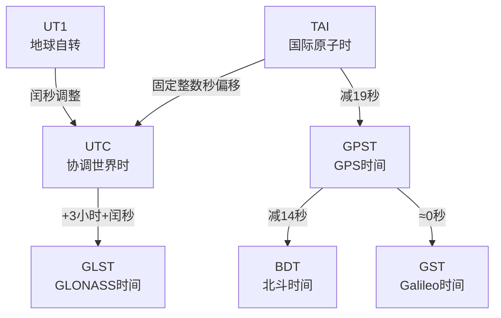

<div align="center">
    <a name="Top"></a>
	<h1>⏰ 导航算法常用的时间系统</h1>
    
    
    
    
    
</div>

## 📖 目录

- [📖 目录](#-目录)
- [1. 概述](#1-概述)
- [2. 基本时间系统](#2-基本时间系统)
  - [2.1 恒星时（Sidereal Time, ST）](#21-恒星时sidereal-time-st)
  - [2.2 太阳时与世界时](#22-太阳时与世界时)
  - [2.3 原子时与国际原子时（TAI）](#23-原子时与国际原子时tai)
  - [2.4 协调世界时（UTC）](#24-协调世界时utc)
- [3. GNSS时间系统](#3-gnss时间系统)
  - [3.1 GPS时间（GPST）](#31-gps时间gpst)
  - [3.2 北斗时间（BDT）](#32-北斗时间bdt)
  - [3.3 GLONASS时间（GLST）](#33-glonass时间glst)
  - [3.4 Galileo时间（GST）](#34-galileo时间gst)
  - [3.5 各系统时间偏差](#35-各系统时间偏差)
- [4. 时间表示方法](#4-时间表示方法)
  - [4.1 儒略日（Julian Day, JD）](#41-儒略日julian-day-jd)
  - [4.2 简化儒略日（Modified Julian Day, MJD）](#42-简化儒略日modified-julian-day-mjd)
  - [4.3 年积日（Day of Year, DOY）](#43-年积日day-of-year-doy)
  - [4.4 GNSS周内时间表示](#44-gnss周内时间表示)
- [5. 时间系统转换](#5-时间系统转换)
  - [5.1 时间系统关系总览](#51-时间系统关系总览)
  - [5.2 儒略日与日历日期转换](#52-儒略日与日历日期转换)
  - [5.3 GPS周与日历日期转换](#53-gps周与日历日期转换)
  - [5.4 闰秒处理](#54-闰秒处理)
- [6. 仿真中的时间管理](#6-仿真中的时间管理)
  - [6.1 仿真时间推进](#61-仿真时间推进)
  - [6.2 采样率与时间分辨率](#62-采样率与时间分辨率)
- [7. 编程实现工具类](#7-编程实现工具类)
- [8. 常见问题与注意事项](#8-常见问题与注意事项)
- [9. 总结](#9-总结)
- [📚 参考资料](#-参考资料)

<br/>

## 1. 概述

时间系统是导航定位的**基石**，任何导航算法都离不开精确的时间测量和同步。全球导航卫星系统（GNSS）通过测量信号传播时间来计算距离，因此时间系统的精确度和稳定性直接决定了定位精度。

> 💡 **直观理解**：GNSS定位本质上是"用时间测量距离"。
> - 1纳秒（ns）的时间误差 ≈ 0.3米的距离误差
> - 要达到米级定位精度，时间同步精度需达到纳秒级

一个完整的时间系统包含两个基本要素：
- **时间起点（历元）**：时间计算的起始参考点
- **时间间隔尺度**：时间单位的基本长度

---

## 2. 基本时间系统

### 2.1 恒星时（Sidereal Time, ST）

**定义**：以春分点为基本参考点，由春分点周日视运动确定的时间称为恒星时。

**特点**：
- 基于地球自转周期（相对于遥远恒星）
- 1恒星日 = 地球相对于春分点自转360°所需时间
- 1恒星日 ≈ **23小时56分4.09秒**（平太阳时）
- 主要用于天文观测和卫星轨道计算
- 恒星时 = 春分点的时角

**为什么恒星日比太阳日短？**
地球在自转的同时还在公转，一天后地球需要多转约1°才能再次对准太阳。

### 2.2 太阳时与世界时

#### 真太阳时
以真太阳作为基本参考点，由其周日视运动确定的时间。由于地球公转轨道是椭圆且存在黄赤交角，真太阳时**不均匀**。

#### 平太阳时
引入虚拟的"平太阳"概念，在赤道上以均匀速度运行，其速度等于真太阳周年运动的平均速度。
- 平太阳连续经过同一子午圈的时间称为一个**平太阳日**
- 1平太阳日 = 24平太阳时
- 日常使用的时间系统基于平太阳时

#### 世界时（Universal Time, UT）

**定义**：以本初子午线（0°经线）的平太阳时为基准的时间系统。

**分类**：
| 类型 | 含义 | 用途 |
| :--- | :--- | :--- |
| **UT0** | 直接通过天文观测得到的世界时 | 原始观测 |
| **UT1** | 对UT0进行极移改正后的世界时 | 反映地球自转真实角度 |
| **UT2** | 对UT1进行季节性变化改正后的世界时 | 理论意义，少用 |

**特点**：
- 基于地球自转
- 不均匀且逐渐变慢（每天约增加2-3毫秒）
- UT1是天文学和大地测量学中的重要参考

### 2.3 原子时与国际原子时（TAI）

#### 原子时（AT）

**定义**：以原子谐振信号周期为标准，并对它进行连续计数的时标。

**秒定义**（1967年起）：
> 铯-133原子基态的两个超精细能级之间跃迁所对应辐射的9,192,631,770个周期的持续时间。

**特点**：
- 极其稳定和精确（稳定度可达10⁻¹⁵量级）
- 是现代时间系统的基础
- 不与任何天文现象关联

#### 国际原子时（TAI）

**定义**：由国际计量局(BIPM)根据全球多个实验室的原子钟数据加权平均计算保持的原子时。

**历史**：
- 起点：1958年1月1日0时0分0秒世界时(UT)的瞬间
- 事后发现，在该瞬间TAI与UT的时刻之差为0.0039秒

**特点**：
- 连续均匀的时间尺度
- 不与任何天文现象直接关联
- 为全球提供高精度的时间参考

### 2.4 协调世界时（UTC）

**定义**：以原子秒长为计量单位，在时刻上尽量接近世界时的时间系统。

**核心机制**：
- 时间**尺度**基于TAI（秒长与TAI相同）
- 时刻与UT1相差不超过 **±0.9秒**
- 通过**闰秒（跳秒）**调整保持与UT1接近

**闰秒机制**：
当UTC与UT1相差将超过0.9秒时，在6月30日或12月31日的最后一分钟增加或减少1秒。

| 类型 | 过程 | 说明 |
| :--- | :--- | :--- |
| **正闰秒** | 23:59:59 → 23:59:60 → 00:00:00 | 已发生多次 |
| **负闰秒** | 23:59:58 → 00:00:00 | 理论可能，至今未发生 |

**重要性**：
- 民用时间的基础
- 计算机系统默认时间
- 几乎所有现代设备都使用UTC

---

## 3. GNSS时间系统

### 3.1 GPS时间（GPST）

**定义**：由GPS星载原子钟和地面监控站原子钟维持的时间系统。

**关键参数**：
| 参数 | 值 |
| :--- | :--- |
| **起点** | 1980年1月6日0时0分0秒（UTC） |
| **与TAI关系** | GPST = TAI - 19秒（固定偏差） |
| **闰秒** | 不含闰秒，连续均匀 |
| **时间表示** | 周数(WN) + 周内秒(TOW) |

**特点**：
- 连续均匀的原子时尺度
- 通过导航电文发布与UTC的偏移信息（A0, A1参数）
- 是GPS系统的时间基准

**GPS周翻转问题**：
- GPS周数为10位，范围0-1023
- 每1023周（约19.6年）翻转一次
- 第一次翻转：1999年8月22日
- 第二次翻转：2019年4月7日
- 第三次翻转：2038年（预计）

### 3.2 北斗时间（BDT）

**定义**：由中国北斗卫星导航系统保持的时间系统。

**关键参数**：
| 参数 | 值 |
| :--- | :--- |
| **起点** | 2006年1月1日0时0分0秒（UTC） |
| **与UTC关系** | BDT = UTC + 闰秒累计（截至2023年为+4秒？需核实） |
| **与GPST关系** | BDT = GPST - 14秒（基本恒定，偏差在ns级） |
| **闰秒** | 不含闰秒，连续均匀 |

**特点**：
- 北斗系统独立保持的时间基准
- 通过导航电文发布与UTC和GPST的偏差
- 是北斗系统的时间基准

### 3.3 GLONASS时间（GLST）

**定义**：由GLONASS系统保持的时间系统。

**关键参数**：
| 参数 | 值 |
| :--- | :--- |
| **基准** | 与UTC(SU)保持同步（莫斯科时间） |
| **闰秒** | 包含闰秒调整 |
| **时区偏移** | GLST = UTC(SU) = UTC + 3小时 |

**特点**：
- 是唯一包含闰秒的GNSS时间系统
- 与莫斯科时间同步（UTC+3）
- 现代化后正逐步向UTC直接对齐

### 3.4 Galileo时间（GST）

**定义**：由Galileo卫星导航系统保持的时间系统。

**关键参数**：
| 参数 | 值 |
| :--- | :--- |
| **起点** | 1999年8月22日0时0分0秒（UTC） |
| **与GPST关系** | 初始与GPST同步，后期独立保持 |
| **闰秒** | 不含闰秒，连续均匀 |

**特点**：
- 与GPS时间互操作
- 通过导航电文发布与GPST和UTC的偏移信息
- 欧洲Galileo系统的时间基准

### 3.5 各系统时间偏差

多系统联合定位时需要考虑系统间时间偏差（ISB, Inter-System Bias）：

| 系统 | 相对于GPST的偏差（近似） |
| :--- | :--- |
| GPST | 0（参考） |
| BDT | ≈ -14 秒 |
| GST | ≈ 0 秒（设计对齐，实际ns级偏差） |
| GLONASS | ≈ 3小时 + 闰秒偏移 |

> ⚠️ 注意：精确的系统间偏差需要通过导航电文或实测获取，以上为近似值。

---

## 4. 时间表示方法

### 4.1 儒略日（Julian Day, JD）

**定义**：从公元前4713年1月1日世界时12:00开始连续计算的天数。

**特点**：
- 连续计数，无年月日概念
- 适用于长时间跨度的科学计算
- 小数点后表示一天中的小数部分
- 以正午12点为一天的开始（历史原因）

**计算公式**（Fliegel & Van Flandern公式）：

对于公历日期（年Y、月M、日D）：

```
JD = ⌊365.25Y⌋ + ⌊30.6001(M+1)⌋ + D + 1720981.5
```

其中，如果M≤2，则Y=Y-1，M=M+12。

### 4.2 简化儒略日（Modified Julian Day, MJD）

**定义**：MJD = JD - 2400000.5

**特点**：
- 起点：1858年11月17日世界时0时
- 减小了JD的数值大小，更方便计算
- 以午夜0点为一天的开始（更符合习惯）
- 常用于航天和卫星领域

### 4.3 年积日（Day of Year, DOY）

**定义**：一年中的第几天，取值范围1-365（平年）或1-366（闰年）。

**应用**：
- GNSS观测文件命名（如RINEX格式）
- 简化日期计算
- 数据归档和索引

**闰年判断**：
年份满足以下条件之一即为闰年：
1. 能被4整除但不能被100整除
2. 能被400整除

### 4.4 GNSS周内时间表示

**周内秒（Second of Week, SOW）**：
- 一周中的秒数，取值范围 0 - 604799
- GPS/北斗/Galileo系统常用时间表示方式
- 每周六/周日午夜归零

**周内时（Hour of Week, HOW）**：
- 一周中的小时数，取值范围 0 - 167
- GPS导航电文交接字中使用

**天内秒（Second of Day, SOD）**：
- 一天中的秒数，取值范围 0 - 86399
- 常用于数据记录和处理

**Z计数（Z-count）**：
- GPS导航电文中的时间表示
- 以1.5秒为单位，从GPS周起始计数
- Z计数 × 6 = 子帧起始时刻的周内秒数

---

## 5. 时间系统转换

### 5.1 时间系统关系总览



主要时间系统之间的关系：
```
TAI = UTC + ΔAT  (ΔAT为累计闰秒数)
GPST = TAI - 19秒
BDT ≈ GPST - 14秒
GST ≈ GPST (初始同步)
```

### 5.2 儒略日与日历日期转换

**从日历日期计算儒略日**：

```c
double cal_to_jd(int year, int month, int day, 
                 int hour, int minute, double second) {
    if (month <= 2) {
        year--;
        month += 12;
    }
    double jd = floor(365.25 * year) + floor(30.6001 * (month + 1)) 
                + day + 1720981.5;
    jd += (hour + minute/60.0 + second/3600.0) / 24.0;
    return jd;
}
```

**从儒略日计算日历日期**：

```c
void jd_to_cal(double jd, int *year, int *month, int *day,
               int *hour, int *minute, double *second) {
    double F = jd + 0.5;
    double Z = floor(F);
    double A = Z;
    
    if (Z >= 2299161) {
        int alpha = floor((Z - 1867216.25) / 36524.25);
        A = Z + 1 + alpha - floor(alpha / 4);
    }
    
    double B = A + 1524;
    int C = floor((B - 122.1) / 365.25);
    int D = floor(365.25 * C);
    int E = floor((B - D) / 30.6001);
    
    *day = (int)(B - D - floor(30.6001 * E));
    *month = (E < 14) ? E - 1 : E - 13;
    *year = (*month > 2) ? C - 4716 : C - 4715;
    
    double time = F - Z;
    *hour = (int)floor(time * 24);
    *minute = (int)floor((time * 24 - *hour) * 60);
    *second = ((time * 24 - *hour) * 60 - *minute) * 60;
}
```

### 5.3 GPS周与日历日期转换

**从日历日期计算GPS周**：

```c
void date_to_gps(int year, int month, int day, 
                 int hour, int minute, double second,
                 int *gps_week, double *gps_sow) {
    // 计算儒略日
    double jd = cal_to_jd(year, month, day, hour, minute, second);
    
    // GPS起始时间的儒略日 (1980年1月6日0时)
    double jd_gps0 = cal_to_jd(1980, 1, 6, 0, 0, 0.0);
    
    // 计算相差天数
    double days = jd - jd_gps0;
    
    // 计算GPS周和周内秒
    *gps_week = (int)floor(days / 7);
    *gps_sow = fmod(days, 7) * 86400.0;
    
    // 确保周内秒为正
    if (*gps_sow < 0) {
        *gps_sow += 604800.0;
        (*gps_week)--;
    }
}
```

### 5.4 闰秒处理

**闰秒表（截至2023年6月，TAI-UTC = 37秒）**：

| 生效日期 | TAI-UTC (秒) |
| :--- | :--- |
| 2017-01-01 | 37 |
| 2015-07-01 | 36 |
| 2012-07-01 | 35 |
| 2009-01-01 | 34 |
| 2006-01-01 | 33 |
| 1999-01-01 | 32 |
| ... | ... |
| 1972-01-01 | 10 |

> 📌 注意：闰秒由国际地球自转服务（IERS）提前约6个月公告。

**闰秒对GNSS的影响**：
- GPS/BDS/Galileo时间**不含闰秒**，是连续的
- UTC时间含闰秒，与GNSS时间的偏差随时间增加
- GNSS导航电文中会广播UTC偏移参数，用户可自行转换

---

## 6. 仿真中的时间管理

### 6.1 仿真时间推进

在GNSS信号仿真中，时间是核心变量：

**仿真时间层次**：
| 时间尺度 | 用途 | 典型步长 |
| :--- | :--- | :--- |
| **仿真时间（Epoch）** | 场景/星座更新 | 1s / 0.1s |
| **信号时间（Sample）** | 数字信号采样 | 1/fs（如1/4.092e6 s） |
| **码片时间（Chip）** | 码相位步进 | 1/f_code（如1/1.023e6 s） |

**时间同步要求**：
- 所有卫星的信号在接收机端的时间必须一致
- 考虑信号传播延迟（60-80ms）
- 卫星时钟独立，需模拟钟差

### 6.2 采样率与时间分辨率

**常见采样率选择**：

| 采样率 | 说明 | 适用场景 |
| :--- | :--- | :--- |
| 2.046 MHz | 2倍C/A码速率 | 基本捕获/跟踪 |
| 4.092 MHz | 4倍C/A码速率 | 标准软件接收机 |
| 16.368 MHz | 16倍C/A码速率 | 高精度仿真 |
| 40 MHz+ | 宽带多频信号 | 多频多系统仿真 |

**时间精度要求**：
- 伪距仿真：~cm级精度 → 时间精度需 ~30 ps
- 载波相位仿真：~度级相位精度 → 时间精度需 ~1 ps
- 实际中使用double精度浮点运算通常足够

---

## 7. 编程实现工具类

以下是一个完整的Python时间处理工具类：

```python
import math
import datetime

# 闰秒表 (TAI - UTC, 截至2023年)
# 格式: (year, month, day, tai_minus_utc)
LEAP_SECONDS = [
    (2017, 1, 1, 37.0),
    (2015, 7, 1, 36.0),
    (2012, 7, 1, 35.0),
    (2009, 1, 1, 34.0),
    (2006, 1, 1, 33.0),
    (1999, 1, 1, 32.0),
    (1997, 7, 1, 31.0),
    (1996, 1, 1, 30.0),
    (1994, 7, 1, 29.0),
    (1993, 7, 1, 28.0),
    (1992, 7, 1, 27.0),
    (1991, 1, 1, 26.0),
    (1990, 1, 1, 25.0),
    (1988, 1, 1, 24.0),
    (1985, 7, 1, 23.0),
    (1983, 7, 1, 22.0),
    (1982, 7, 1, 21.0),
    (1981, 7, 1, 20.0),
    (1972, 7, 1, 10.0),
    (1972, 1, 1, 10.0),
]

# GPS时间起点: 1980年1月6日0时UTC
GPS_EPOCH_JD = 2444244.5  # 儒略日


def cal_to_jd(year, month, day, hour=0, minute=0, second=0.0):
    """日历日期转儒略日"""
    if month <= 2:
        year -= 1
        month += 12
    
    jd = (math.floor(365.25 * year) + 
          math.floor(30.6001 * (month + 1)) + 
          day + 1720981.5)
    jd += (hour + minute / 60.0 + second / 3600.0) / 24.0
    return jd


def jd_to_cal(jd):
    """儒略日转日历日期，返回 (year, month, day, hour, minute, second)"""
    F = jd + 0.5
    Z = math.floor(F)
    A = Z
    
    if Z >= 2299161:
        alpha = math.floor((Z - 1867216.25) / 36524.25)
        A = Z + 1 + alpha - math.floor(alpha / 4)
    
    B = A + 1524
    C = math.floor((B - 122.1) / 365.25)
    D = math.floor(365.25 * C)
    E = math.floor((B - D) / 30.6001)
    
    day = int(B - D - math.floor(30.6001 * E))
    month = E - 1 if E < 14 else E - 13
    year = C - 4716 if month > 2 else C - 4715
    
    time_frac = F - Z
    hour = int(math.floor(time_frac * 24))
    minute = int(math.floor((time_frac * 24 - hour) * 60))
    second = ((time_frac * 24 - hour) * 60 - minute) * 60
    
    return year, month, day, hour, minute, second


def date_to_gps_week(year, month, day, hour=0, minute=0, second=0.0):
    """日历日期转GPS周和周内秒"""
    jd = cal_to_jd(year, month, day, hour, minute, second)
    days = jd - GPS_EPOCH_JD
    gps_week = int(math.floor(days / 7))
    gps_sow = (days % 7) * 86400.0
    if gps_sow < 0:
        gps_sow += 604800.0
        gps_week -= 1
    return gps_week, gps_sow


def gps_week_to_date(gps_week, gps_sow):
    """GPS周和周内秒转日历日期"""
    days = gps_week * 7 + gps_sow / 86400.0
    jd = GPS_EPOCH_JD + days
    return jd_to_cal(jd)


def get_tai_utc_offset(year, month, day):
    """获取指定UTC日期对应的 TAI - UTC 值"""
    target_jd = cal_to_jd(year, month, day)
    for y, m, d, offset in LEAP_SECONDS:
        ls_jd = cal_to_jd(y, m, d)
        if target_jd >= ls_jd:
            return offset
    return 10.0  # 1972年之前的默认值（一般不会用到）


def utc_to_gps(year, month, day, hour=0, minute=0, second=0.0):
    """UTC时间转GPS时间"""
    # UTC -> TAI
    tai_utc = get_tai_utc_offset(year, month, day)
    # TAI -> GPS (GPST = TAI - 19s)
    gps_utc = tai_utc - 19.0
    
    # 调整秒数
    total_seconds = second + gps_utc
    if total_seconds >= 60:
        second = total_seconds - 60
        minute += 1
        # 继续进位（简化，实际需完整日期计算）
    else:
        second = total_seconds
    
    # 转GPS周
    gps_week, gps_sow = date_to_gps_week(year, month, day, hour, minute, second)
    return gps_week, gps_sow


def day_of_year(year, month, day):
    """计算年积日 (DOY)"""
    days_in_month = [31, 28, 31, 30, 31, 30, 31, 31, 30, 31, 30, 31]
    
    # 闰年判断
    if (year % 4 == 0 and year % 100 != 0) or (year % 400 == 0):
        days_in_month[1] = 29
    
    doy = sum(days_in_month[:month-1]) + day
    return doy


def is_leap_year(year):
    """判断是否为闰年"""
    return (year % 4 == 0 and year % 100 != 0) or (year % 400 == 0)


# 使用示例
if __name__ == "__main__":
    print("=== 时间系统转换示例 ===")
    print()
    
    # 1. 儒略日转换
    jd = cal_to_jd(2026, 10, 21, 12, 0, 0)
    print(f"2026-10-21 12:00:00 的儒略日: {jd:.5f}")
    
    y, m, d, h, mi, s = jd_to_cal(jd)
    print(f"儒略日 {jd:.5f} 对应的日期: {y}-{m:02d}-{d:02d} {h:02d}:{mi:02d}:{s:.2f}")
    print()
    
    # 2. GPS周转换
    week, sow = date_to_gps_week(2026, 10, 21, 0, 0, 0)
    print(f"2026-10-21 对应的GPS周: {week}, 周内秒: {sow:.1f} (第{sow/86400:.1f}天)")
    print()
    
    # 3. 闰秒
    offset = get_tai_utc_offset(2026, 10, 21)
    print(f"2026年 TAI - UTC = {offset:.0f} 秒")
    print(f"2026年 GPST - UTC = {offset - 19:.0f} 秒")
    print()
    
    # 4. 年积日
    doy = day_of_year(2026, 10, 21)
    print(f"2026-10-21 是第 {doy} 天")
    print(f"2026年是闰年: {is_leap_year(2026)}")
```

---

## 8. 常见问题与注意事项

### ❓ 常见问题

**Q1: 为什么GNSS时间不含闰秒？**
A: 闰秒会导致时间不连续，影响导航定位的连续性和精确性。GNSS系统选择保持连续的原子时尺度，通过广播UTC偏移参数让用户自行转换。

**Q2: GPS周翻转会有什么影响？**
A: 10位周数每19.6年翻转。现代接收机和数据格式（如RINEX 3.x）已扩展周数位数，影响不大。但老旧设备可能出现问题。

**Q3: 多系统联合定位时时间系统怎么统一？**
A: 通常统一到一个系统的时间（如GPST），其他系统的时间偏差作为未知参数（ISB）估计，或通过导航电文的偏差参数修正。

### ⚠️ 注意事项

1. **单位一致性**：确保所有时间值使用统一单位（秒、毫秒、微秒）
2. **精度问题**：使用 `double` 类型存储时间值，长时间跨度注意精度损失
3. **闰秒更新**：闰秒表需要定期更新，否则时间转换会出错
4. **时区处理**：所有导航计算使用UTC/GPST，显示时才转本地时间
5. **周内秒翻转**：计算时间差时注意周翻转（加减604800秒调整）
6. **系统间偏差**：多系统融合时注意各系统时间基准的差异
7. **仿真时间同步**：仿真中注意卫星时间和接收机时间的区别

---

## 9. 总结

时间系统是导航算法的基石，理解各种时间系统的特点、关系和转换方法对于开发高精度导航定位应用至关重要。

**核心要点回顾**：

1. **原子时是基础**：所有现代GNSS时间系统都基于原子时，连续均匀
2. **UTC是民用标准**：含闰秒，与地球自转保持同步
3. **GNSS时间连续**：GPS/BDS/Galileo时间不含闰秒，是连续的原子时
4. **转换是关键**：不同系统间需要精确的时间转换
5. **精度决定定位**：纳秒级的时间精度对应米级的定位精度

通过正确理解和处理时间系统，可以确保导航算法的精度和可靠性，为各种应用提供准确的定位和时间服务。

---

## 📚 参考资料

1. **IS-GPS-200**: Navstar GPS 空间段/导航用户段接口文件（时间相关章节）
2. **北斗卫星导航系统空间信号接口控制文件**（北斗时间系统部分）
3. **Seidelmann, P. K. (1992).** *Explanatory Supplement to the Astronomical Almanac.* University Science Books.
4. **Hofmann-Wellenhof, B., et al. (2007).** *GNSS - Global Navigation Satellite Systems.* Springer.
5. **Misra, P., & Enge, P. (2006).** *Global Positioning System: Signals, Measurements, and Performance.*
6. **Kaplan, E. D., & Hegarty, C. J. (2017).** *Understanding GPS/GNSS: Principles and Applications.* Artech House.
7. **IERS Bulletin C:** 国际地球自转服务发布的闰秒公告

<p align="center">
    <sub>更新时间：2026年10月 | </sub>
    <a href="#Top">返回顶部 ↑</a>
</p>
